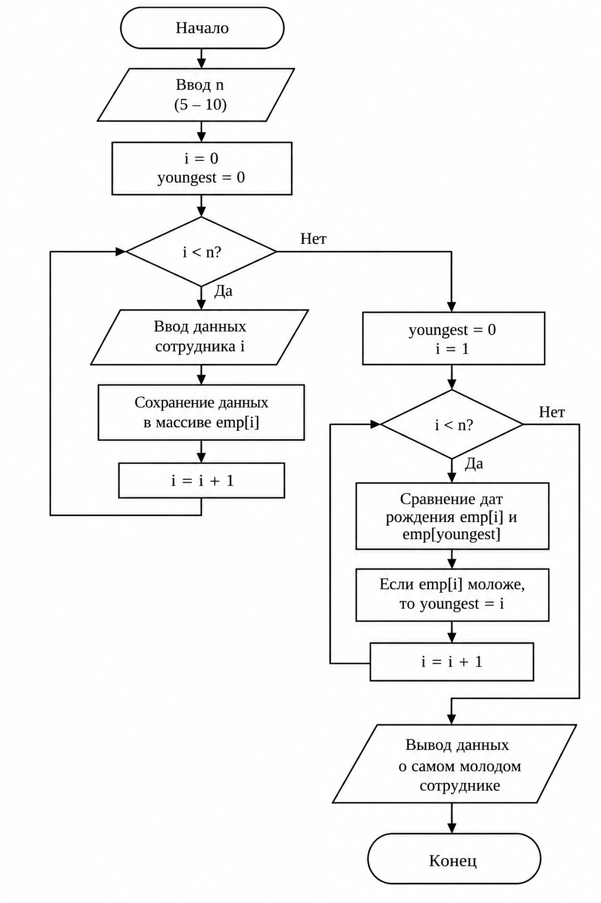

# Задание 3. Работа со структурами

## Вариант 9. Сотрудник

### Постановка задачи

Создать структуру для хранения информации о сотрудниках.

Структура должна содержать следующие поля:

- фамилия;
- имя;
- отчество;
- должность;
- зарплата;
- дата рождения.

Организовать ввод данных о нескольких сотрудниках и определить самого молодого сотрудника.

---

## Структура данных

Для хранения информации о сотруднике используется структура:

```c
struct Employee
{
    char surname[50];
    char name[50];
    char patronymic[50];
    char position[50];
    float salary;

    int day;
    int month;
    int year;
};
```

---

## Алгоритм работы программы

1. Ввести количество сотрудников.
2. Для каждого сотрудника ввести:
   - фамилию;
   - имя;
   - отчество;
   - должность;
   - зарплату;
   - дату рождения.
3. Сохранить введённые данные в массив структур.
4. Сравнить даты рождения сотрудников.
5. Определить сотрудника с наиболее поздней датой рождения.
6. Вывести данные самого молодого сотрудника.

---

## Блок-схема алгоритма



## Исходный код

```c
#define _CRT_SECURE_NO_WARNINGS
#include <stdio.h>
#include <locale.h>

struct Employee
{
    char surname[50];
    char name[50];
    char patronymic[50];
    char position[50];
    float salary;

    int day;
    int month;
    int year;
};

int main()
{
    setlocale(LC_ALL, "RUS");

    struct Employee employees[10];

    int n;
    int youngest = 0;

    printf("Введите количество сотрудников (от 5 до 10): ");
    scanf("%d", &n);

    for (int i = 0; i < n; i++)
    {
        printf("\nСотрудник %d\n", i + 1);

        printf("Фамилия: ");
        scanf("%s", employees[i].surname);

        printf("Имя: ");
        scanf("%s", employees[i].name);

        printf("Отчество: ");
        scanf("%s", employees[i].patronymic);

        printf("Должность: ");
        scanf("%s", employees[i].position);

        printf("Зарплата: ");
        scanf("%f", &employees[i].salary);

        printf("Дата рождения (день месяц год): ");
        scanf("%d %d %d",
              &employees[i].day,
              &employees[i].month,
              &employees[i].year);
    }

    for (int i = 1; i < n; i++)
    {
        if (employees[i].year > employees[youngest].year)
        {
            youngest = i;
        }
        else if (employees[i].year == employees[youngest].year &&
                 employees[i].month > employees[youngest].month)
        {
            youngest = i;
        }
        else if (employees[i].year == employees[youngest].year &&
                 employees[i].month == employees[youngest].month &&
                 employees[i].day > employees[youngest].day)
        {
            youngest = i;
        }
    }

    printf("\nСамый молодой сотрудник:\n");

    printf("Фамилия: %s\n", employees[youngest].surname);
    printf("Имя: %s\n", employees[youngest].name);
    printf("Отчество: %s\n", employees[youngest].patronymic);
    printf("Должность: %s\n", employees[youngest].position);
    printf("Зарплата: %.2f\n", employees[youngest].salary);

    printf("Дата рождения: %02d.%02d.%d\n",
           employees[youngest].day,
           employees[youngest].month,
           employees[youngest].year);

    return 0;
}
```

---

## Пример работы программы

### Входные данные

```text
Введите количество сотрудников (от 5 до 10): 5

Сотрудник 1
Фамилия: Иванов
Имя: Иван
Отчество: Иванович
Должность: Инженер
Зарплата: 55000
Дата рождения (день месяц год): 12 5 2003

Сотрудник 2
Фамилия: Петров
Имя: Алексей
Отчество: Сергеевич
Должность: Программист
Зарплата: 70000
Дата рождения (день месяц год): 20 7 2004

Сотрудник 3
Фамилия: Сидоров
Имя: Максим
Отчество: Андреевич
Должность: Аналитик
Зарплата: 62000
Дата рождения (день месяц год): 10 2 2002

Сотрудник 4
Фамилия: Орлов
Имя: Дмитрий
Отчество: Андреевич
Должность: Программист
Зарплата: 65000
Дата рождения (день месяц год): 15 8 2007

Сотрудник 5
Фамилия: Смирнов
Имя: Артем
Отчество: Олегович
Должность: Менеджер
Зарплата: 58000
Дата рождения (день месяц год): 3 11 2005
```

### Результат

```text
Самый молодой сотрудник:
Фамилия: Орлов
Имя: Дмитрий
Отчество: Андреевич
Должность: Программист
Зарплата: 65000.00
Дата рождения: 15.08.2007
```

---

## Результат работы

В программе реализована структура `Employee`, содержащая основные данные о сотруднике.

Для хранения нескольких записей используется массив структур. Программа сравнивает даты рождения сотрудников и выводит информацию о самом молодом сотруднике.
